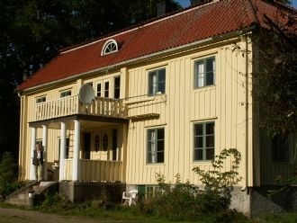
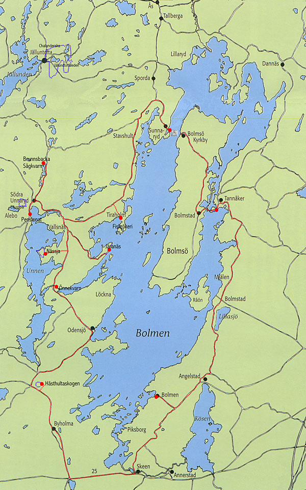

# 6. - 15. August 2027

## Letze Woche der Sommerferien 

Wir nehmen die Nachtfähre am Freitag ab Rostock. Start in Stahnsdorf gegen 16 Uhr. Fähre Rostock 23 Uhr. Samstag 7 Uhr in Trelleborg. 250 km zum Quartier.
Rückreise erfolgt eine Woche später am Samstagnachmittag, wir nehmen die Nachtfähre ab Trelleborg und sind Sonntag Mittag wieder zur Hause.

Unser Quartier liegt am Nordende des Bolmen, dem größten See Smaland.
Wir haben Betten in drei Ferienhäusern auf dem Hof Liljenäs Gård, 600m zur Badestelle/Bootseinsetzstelle.
Das Hauptgebäude ist ein historischer Bau von 1760 mit 8 Doppelzimmern und einem großen Saal. Dazu kommen zwei kleinere Häuser.

Frühstück + Abendessen machen wir selbst. Eine große Küche und ein Grillplatz sind vorhanden.

Wir machen 8 Tagesfahrten zwischen 30 und 50 km. 
Diese Wanderfahrt richtet sich auch an Anfänger aller Altersklassen und Ruderer die eine entspannte Wanderfahrt, ohne Quartierwechsel suchen.

