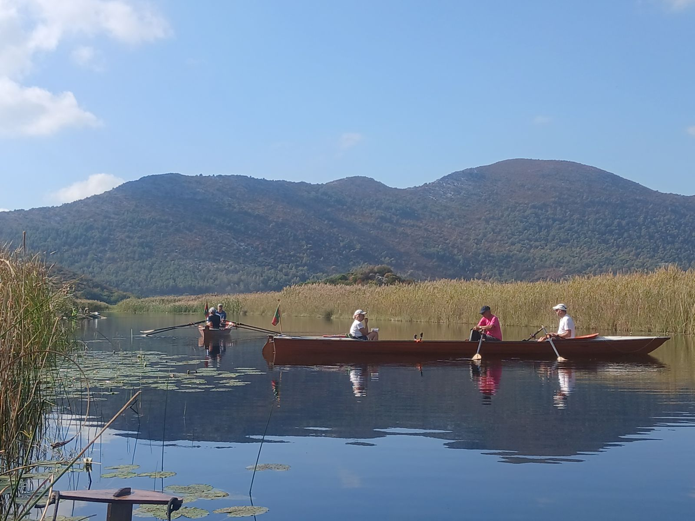
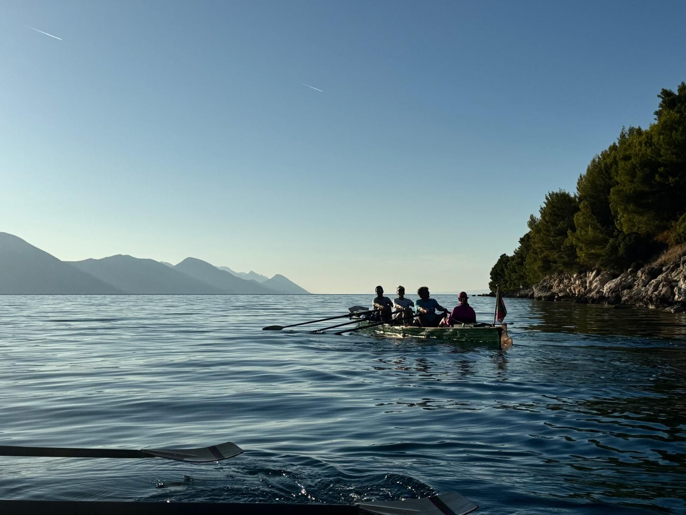

# Auf Adria und Neretva

Auch dieses Jahr zog es wieder nach Süden. Das Ziel war wieder Kroatien, allerdings dieses Mal so weit wie noch nie, bis direkt vor die Grenze von Bosnien zur Deltamündung des Flusses Neretva.

Freitag früh startete der Anhängertransport, am Nachmittag der zweite Kleinbus.
Am Samstag trafen beide Busse im winzigen Ort Blace in Kroatien ein.
Wir hatte eine Villa und zwei Ferienwohnungen gebucht.
Die Villa sogar mit Pool. Der Pool allerdings entgegen dem Versprechen ungeheizt.

Nachdem wir am Morgen die Boote über eine hohe Kaimauer ins Wasser bekommen hatten, ging es raus aufs Meer.
Blace liegt in einer langgestreckten, fjordartigen Bucht. Wir hielten auf das gegenüberliegende Ufer des Fjords zu und ruderten nach Norden.
Im Ort Trpanji legten direkt neben dem Fähranleger, an der Hafenmauer an und machten Pause.
Es gab sogar offene Gaststätten.
Auf dem Hinweg hatten wir leichten Schiebewind, wir erwarteten einen anstrengenden Rückweg, aber zur Mittagspause war der Wind vollkommen eingeschlafen. Bei Windstille ging es zurück nach Blaceh, insgesamt 39 km.
Wir suchten eine bessere Anlegestelle. Leider war der „Traumstand“ ziemlich schlammig, aber alles war besser als die Kaimauer.

Am zweiten Tag ging es den Fjord in Richtung Süden. Hier mussten wir aufpassen nicht in Bosnische Gewässer zu geraten. Direkt an der riesigen Brücke über den Fjord wurden wir von der kroatischen Küstenwache noch einmal ermahnt.
Auf ca. 9 km ist hier das östliche Ufer Bosnien, Bosniens einziger Meereszugang.
Wir hielten uns am westlichen Ufer. 
Das mit der Gaststätte zur Mittagspause scheiterte. Der Ort Diuba Stonska war eine Geisterstadt.
Wir machten Pause an einem kleinen Strand, bevor es wieder zurück ging.
Heute war uns Aeolus nicht ganz so gnädig, aber der Gegenwind hielt sich in Grenzen.
Bei durchgehender Sonne und 23 Grad schafften wir die 43 km recht entspannt.
In Blace hatten wir jetzt die ideale Anlegestelle gefunden. Direkt am Kirchenstrand konnte man entspannt anlegen und die Boote lagern.

Wegen etwas mehr Wind ging es am folgenden Tag ins Delta der Neretva.
Nur 1,5 km entfernt gab es eine Schleuse die uns direkt in die Mala (kleine) Neretva führte.
Zu jeder vollen Stunde wird hier geschleust.
Die Mala Neretva ist ein 30-40m breiter Fluss, die Ufer gesäumt von Mandarinen Plantagen, die voll mit Früchten hingen.
Es gibt viele Nebenarme, teilweise nur für Kanus befahrbar, teilweise auch breit genug für ein Ruderboot.
Wir wählten den südlichsten Nebenarm. Dieser führt meist in der Nähe, der das Delta begrenzenden Gebirgskante entlang. An dieser Gebirgskante stehen vereinzelt, meist ziemliche baufällige Häuser, die praktische alle Mandarinen Verarbeitung betreiben.
 
Der Arm windet sich endlos durch die Mandarinen Plantagen und endete nach 15 km ziemlich abrupt vor einer Gebirgskante.
Da die Ernte gerade lief, waren viele Leute in den Plantagen, die uns öfter Mandarinen schenkten.

Für den nächsten Tag waren Unwetter mit Sturm und 100l Regen vorhergesagt. 
Anstelle von Rudern machten wir einen Ausflug nach Mostar in Bosnien. Ein Teilnehmer hatte leider seinen Ausweis im Quartier liegen lassen, so dass ein Auto eine Extrarunde drehen musste.

In Mostar bestaunten wir die wiederaufgebaute Brücke über die Neretva, besuchten das Museum und genossen in einem Restaurant ein gutes Mittagessen. Die Restaurantterrasse mit Blick auf die Brücke von Mostar. Glücklicherweise alles unter Dach, es schüttete wie aus Eimern.

Der nächste Tag brachte wieder Sonne und 23 Grad. Daher ging es wieder aufs Meer, dieses Mal nach Norden entlang des Festlands.
Vorbei am Hafen von Ploce nach Gradac.
Das Rudern entlang der Steilküste war beeindruckend. Spärlich bewachsene Kalkfelsen, winzige Buchten mit sehr einsamen Häusern, teilweise am Ufer, teilweise 50m oberhalb des Wassers.

Wir legten die Boote an den Strand im Ort und fanden ein offenes Cafe. Bei weiterer Suche sogar noch eine Bäckerei. Die Enttäuschung war dagegen die Cocktail- Bar. Cocktails gibt es nur im Sommer, im Winter nur Kaffee.

Die erste Strecke des Rückwegs hatten wir mit ein paar Wellen zu kämpfen, die sich aber bald legten.
In Ploce bogen wir ins Hafenbecken, direkt hinter dem Hafen ging es in einen kleinen Kanal. Dieser lag direkt neben dem örtlichen Supermarkt.
Das Shopping Boot machte sich dann extrem beladen auf den Rückweg, aber wir sparten uns den abendlichen Einkaufstrip mit dem Auto.

Bei weiter warmen Wetter steuerten wir die westlichen Fjordseite an. Hier gab es große Buchten mit vorgelagerten Inseln. Nach einiger Suche gelang es sogar zwei offene Gaststätten zu finden.
Die zweite war anscheinend das regional bekannte Gourmet- Rest mit zugehörigen Promi- Publikum.
Wir hatten den ganzen Tag einige Schauerwolken beobachtet. Wir blieben etwas länger bei de Promis, um den Regen zu vemeiden.
Aber auf dem Rückweg bekamen wir dann doch etwas Sprühregen ab. Es lohnte kaum die Regenjacken.

Für diesen Tag waren für den Nachmittag Gewitter angesagt. Wir ruderten nur eine kürzere Strecke ins Delta. 
Durch die Schleuse auf die Mala Neretva mit Shoppingstop in Opuzen, direkt neben der Brücke war der Supermarkt nur 400m entfernt.
Wir kamen bereits am frühen Nachmittag zurück, allerdings kam das Gewitter erst am Abend. Da hätten wir auch weiter rudern können.

Heute hatten wir den ablandigen Wind etwas unterschätzt. Wir folgten der Küste nördlich nach Ploce, das ging noch. Leider bogen wir dann in den Hafen ab, um ins Delta zu kommen. Allerdings pfiff der Wind genau aus dieser Richtung durch das Tal.
Wir kämpften uns bei heftigen Wind in den Hafen herein, teilweise jeder Schlag nur zentimeterweise vorwärts, bis wir endlich die schützenden Gräben erreichten.
Wir folgten dem nördlichsten Arm des Neretva Deltas, der in einer Sackgasse in einem Tallkessel endete. Ein großer Sumpfteich, auf drei Seiten von Bergen umgeben.
Das nördliche Delta war etwas weniger mandarinenlastig, dafür viel Oliven und vereinzelt Feigen- und Granatapfelbäume.

Auf dem Rückweg haben wir noch an einem Straßenstrand (Ufer der Neretva) angelegt und größere Menge Mandarinen nachgekauft. Der Verbrauch der Ruderer ist hoch.

Am nächsten Tag ging es wieder ins südliche Delta. Auch hier wollten wir die Grenze des Delta erreichen.
Ein endloser Graben durch die Mandarinen Plantagen hinter Opuzen führte direkt in die Berge. Wieder ein beeindruckender Talkessel.
Das Highlight war eine offene Gaststätte mitten im Nirgendwo. Von hier werden Touristentouren mit dem Boot angeboten. Wir konnten anlegen und uns stärken.
Auf dem Rückweg hatten wir leider mit etwas Gegenwind zu kämpfen, aber wir schafften es gerade vor Sonnenuntergang zurück nach Blace.

Heute wieder mal ein Ausflug nach Ploce. Nach dem obligatorischen Shopping führten uns die Gräben wieder ins Delta.
Diesmal bogen wir aber recht früh wieder nach Süden ab und erreichten über die Stara (Alte) Neretva wieder den Hauptarm.
Die Stara Neretva ist von hohem Schilf gesäumt, dahinter teilweise Mandarinen Plantagen, aber man fühlt sich erstmal wie im Donaudelta, bis man plötzlich wieder den Hauptarm erreicht.

Am vorletzten Tag wollten wir jetzt endlich die Neretva aufwärts bis zur bosnischen Grenze rudern. Der ablandige Wind war schwächer als in den letzten Tagen.
Es ging zunächst durch die Schleuse von Blace auf die Mala Neretva und dann über die Schleuse in Opuzen auf die Neretva.
Ab hier hatten wir mit leichter Gegenströmung zu kämpfen, aber wir erreichten den Grenzort und legten am Steg des örtlichen Rudervereins an. Leider war niemand da.
Der Rückweg ging etwas entspannter, so dass wir kurz vor Sonnenuntergang nach 42 km zurück waren.

Die Abschlusstour führte uns den Fjord nach Süden, bis direkt vor die bosnische Grenze, nach Klek.
Selten einen so toten Badeort gefunden. Es hatte wirklich nichts offen, aber der Strand war schön und wir sonnten uns auf den Bänken der Uferpromenade.

Am Nachmittag luden wir auf und machten uns reisefertig für den sehr frühen Aufbruch am nächsten Morgen.

Die Rückfahrt lief besonders für den Anhängertransport anstrengender als geplant. Vom Velebit Gebirge fiel der Bora herab. Für LKW, Busse und Anhänger war die Autobahn gesperrt.
Wir mussten die Uferstraße bis kurz vor Rijeka fahren. Landschaftlich äußerst reizvoll, nur nicht für den Fahrer.
Die war nämlich, bei diesem Wind auch alles andere als angenehm zu fahren.
Am späten Abend kam auch der Anhängertransport in Regensburg an. (wie immer vielen Dank an den Regensburger RK für die unkomplizierte Übernachtung)

Sonntag war es dann nur noch ein Katzensprung zurück nach Stahnsdorf.
