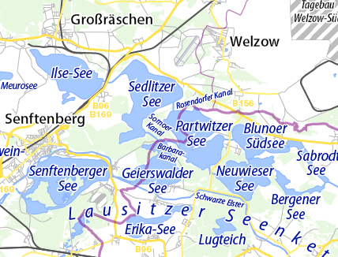

# Auf künstlichen Seen in der Lausitz

Die Lausitzer Seenplatte ist eine künstlich angelegte Seenplatte, die aus den ehemaligen Tagebauen rund um Senftenberg besteht. 
Der Senftenberger See wurde bereits zu DDR Zeiten geflutet, weitere Seen kamen nach der Wende hinzu.
Allerdings waren die Versprechen zu Nutzbarkeit stets etwas optimistisch.
2013 wurden uns drei Seen versprochen, 4 Wochen vor dem Eröffnungstermin waren es dann nur noch zwei und die Eröffnungsveranstaltung geriet zur peinlichen Farce. 
Nun war für 2026 die Nutzung für fünf Seen angekündigt und zu unserem Erstaunen wurden auch Anfang Juli wirklich alle drei Seen zur Nutzung frei gegeben.

Anfang Oktober machten wir uns mit 6 Vierern auf dem Anhänger nach Tätzschwitz bei Geierswalde am Geierswalder See. Wir hatten zwei Ferienwohnungen im Ort und eine weitere im Nachbarort. Alle sehr gut ausgestattet, die größte "Das gelbe Haus" herausragend und uneingeschränkt zu empfehlen.
Die Quartiere lagen etwas abseits des Sees. Die Quartiere direkt am See sind sehr stylisch, aber geradezu unverschämt teuer.

Wir luden unsere Boote am Anglerstrand ab (vielen Dank an unsere Wirtin im Gelben Haus) und starteten am Samstag früh auf die große Runde nach Norden.
Zunächst über den Geierswalder See, optisch sah das schon fast nach natürlichem See aus, die Ufer bereits ziemlich bewachsen, die Wasserqualität recht ordentlich. 
Dann durch einen kurze Durchstich zum Partwitzer See. Dieser ist auch schon ein paar Jahre fertig, so dass der optisch einigermaßen als natürlicher See durchgehen konnte.
Danach weiter auf den Sedlitzer See. Dieser ist neu eröffnet und sieht noch sehr nach Kiesteich aus. Darüber hinaus sind die Ufer nahezu komplett abgesperrt. Überall werden sie noch befestigt, Anlegen praktisch unmöglich.

Weiter zum Tunnel zum nördlichsten See (Großräschener See). Hier hat leider die Schifffahrtsverwaltung mal wieder einen technischen Leckerbissen gebaut. Eine Ampelregelung für den Schiffstunnel, leider zeitgesteuert und nicht bedarfsgesteuert. 
Wir hatten eine endlose Wartezeit, trotz fehlendem Verkehr. Dazu kam noch, dass die Ampel den einschiffigen Verkehr nur für Motorboote forderte, wenn man statt dessen auf die Freigabe für muskelbetriebene Boote wartete, dann hätte man im Tunnel (6m Breite) Gegenverkehr gehabt.
In weiser Voraussicht definierten wir uns als Motorboote. Allerdings hatte die Ampel anscheinend einen Sensor, der "Motorboote" nur alle drei Minuten durchlässt. 
Der Tunnel selbst ist hell beleuchtet und wenn man die Mitte trifft auch ruderbar. Vielleicht nehmen wir beim nächste Mal BigBlades mit. 

Die Pause im Hafenbecken von Großräschen ist leider eigentlich für Ruderboote nicht erlaubt, nur für Yachten. Wir fanden einen Platz im recht leeren Hafenbecken und sogar eine offene Kneipe, der allerdings am Samstag Mittag schon das Eis (aber nicht das Bier) ausgegangen war.
Die Wasserqualität am Hafenbecken war katastrophal. Baden würde man am daneben liegenden Strand sicher nicht.

Zurück ging es auf direktem Weg über den Sedlitzer See, vorbei am "Rostigen Nagel" zurück nach Geierswalde.
Einige Ruderer bestiegen den Aussichtsturm "Rostiger Nagel". Erfreulicherweise sogar ohne Eintritt.

Der zweite Tag führte uns durch die Koschener Schleuse zum Senftenberger See. Die Schleuse bedient man selbst. Es passen exakt 6 Vierer in die Kammer.
Auch hier gibt es wieder einen einschiffigen Tunnel, der aber kürzer ist und die Ampeln haben eine Bedarfssteuerung.

Danach erreichten wir den Senftenberger See. Dieser ist bereits 1972 geflutet und macht daher schon einen etwas natürlicheren Eindruck als die neueren Seen.
Allerdings wirkt die Insel mitten im See immer noch sehr künstlich und nicht fertig.
Wir drehten eine große Seerunde (nicht um die Insel, das ist gesperrt) und legten dann am Strand neben dem Hafen von Senftenberg an. Schöner Spielplatz und neben einem Restaurant sogar ein Eisstand.

Fazit: Die Seenplatte braucht noch einige Zeit, damit man sie wirklich nutzen kann. Gerade an den beiden neuesten Seen ist praktisch keine Möglichkeit zum Anlegen am Strand, weil fast alle Ufer instabil sind und die Wasserqualität lädt hier zum maximal zum Bootfahren, aber nicht zum Baden ein.

Leider setzen anscheinend viele Übernachtungseinrichtungen sehr auf Luxustourismus. Hoffen wir, dass sie ihr Publikum finden. Aber wer Preise bis zu 100 Euro/Person/Nacht aufruft muss dann auch liefern.
Von dieser Kritik sind unsere Ferienwohnungen rund um Tätzschwitz ausdrücklich ausgenommen. Super Unterkünfte zu realistischen Preisen. Speziell das "Gelbe Haus" mit insgesamt 18 Betten ist ei ideales Quartier für eine Gruppe Wassersportler.

